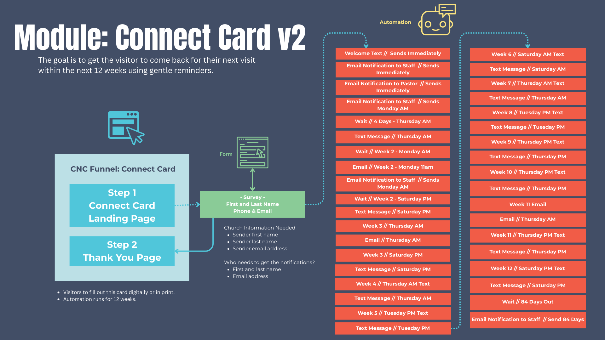

# SOP: \[CNC] Connect Card Module

**Module Name:** Connect Card
**Module Prefix:** CNC
**Version:** 1.0
**Last Updated:** Sep 6, 2025
**Owner:** Church Brand Guide Ops

---

## 1.0 Purpose and Scope

**Purpose**
The Connect Card module (\[CNC]) exists to capture first-time guest information, initiate a structured 12-week follow-up system, and coordinate staff responses. It ensures visitors feel welcomed, cared for, and invited into next steps with the church.

**Scope (In-Scope):**

* Funnel with survey capture and thank-you page
* Automated workflows with email/SMS follow-up for 12 weeks
* Staff notifications and task prompts
* Custom values for guest communication

**Audience:**

* Implementers (agency staff building module)
* Church communications and guest services team
* Ministry leaders responsible for follow-up

---

## 2.0 Asset Inventory

### 2.1 Folder Structure

All assets live in **\[Spoke] – Connect Card** unless noted otherwise.
Sub‑folders: Funnels, Forms, Workflows, Email Templates, SMS Snippets.

All assets are stored in folder:
`[Spoke] – Connect Card`

### 2.2 Assets

* **Funnels**

    * `[CNC] – Connect Card Funnel`

        * Page 1: `[CNC Start]` — Survey entry page
        * Page 2: `[CNC Thank You]` — Post-submission confirmation

* **Forms / Surveys**

    * `[CNC Connect Card Survey]` 
        * **Fields:** 
            * `contact.lastname`
            * `contact.firstname`
            * `contact.phone`
            * `contact.email`
            * `contact.address`

* **Workflows**

    * `[CNC - 12 Week Follow Up – First Time Guests Workflow]`
        * Trigger: Form submission
        * Logic: 12-week drip with emails, SMS, staff notifications

* **Email Templates**

    * `[CNC - 01 Email Notification to Staff - Immediate]`
    * `[CNC - 02 Email Notification to Staff - Monday AM - Selfie Video]`
    * `[CNC - 03 Email - Week 1 - Tuesday AM]`
    * `[CNC - 04 Email Notification to Staff - Wednesday AM - Written Note]`
    * `[CNC - 05 Email - Week 2 - Monday 11AM]`
    * `[CNC - 06 Email - Notification to Staff - Week 2 Monday AM]`
    * `[CNC - 07 Email - Week 3 Thursday AM]`
    * `[CNC - 08 Email - Week 11 Thursday AM]`
    * `[CNC - 09 Email - Notification to Staff - Week 13]`

* **SMS Snippets**

    * `[CNC - 01 Text - Immediate - SMS Welcome]`
    * `[CNC - 02 Text - Week 1 Thursday AM]`
    * `[CNC - 03 Text - Week 2 Saturday PM]`
    * `[CNC - 04 Text - Week 3 Saturday PM]`
    * `[CNC - 05 Text - Week 4 Thursday AM]`
    * `[CNC - 06 Text - Week 5 Tuesday PM]`
    * `[CNC - 07 Text - Week 6 Saturday AM]`
    * `[CNC - 08 Text - Week 7 Thursday AM]`
    * `[CNC - 09 Text - Week 8 Tuesday PM]`
    * `[CNC - 10 Text - Week 9 Thursday PM]`
    * `[CNC - 11 Text - Week 10 Thursday PM]`
    * `[CNC - 12 Text - Week 11 Thursday PM]`
    * `[CNC - 13 Text - Week 12 Saturday PM]`

---

## 3.0 Custom Value Dictionary

### 3.1 Core Values (Global Brand Assets)

Stored in folder: `[Core] – Brand Values`

| Key                         | Description                     |
| --------------------------- | ------------------------------- |
| `Core_Church_Name`          | Official church name            |
| `Core_Email_Sender`         | Default sender email address    |
| `Core_Name_Sender_First`   | First name of email sender      |
| `Core_Name_Sender_Last`    | Last name of email sender       |
| `Core_Pastor_First_Name`   | Lead pastor first name          |
| `Core_Pastor_Email`         | Lead pastor email address       |
| `Core_URL_Logo`             | URL for church logo             |
| `Core_Phone_Main`           | Main public phone number        |
| `Core_Address_Full`         | Full physical address           |
| `Core_Welcome_Center_Name` | Name of welcome center location |

### 3.2 Spoke Values (Module-Specific)

Stored in folder: `[Spoke] – Connect Card`

| Key                                         | Description                                   |
| ------------------------------------------- | --------------------------------------------- |
| `Spoke_CNC_Form_Survey_URL`               | URL of the Connect Card survey form           |
| `Spoke_CNC_Email_Staff_Notification_Email` | Staff notification recipient email            |
| `Spoke_CNC_Coordinator_First_Name`  | First name of the Connect Card coordinator          |
| `Spoke_CNC_Coordinator_Last_Name`   | Last name of the Connect Card coordinator           |
| `Spoke_CNC_Coordinator_Name`  | Name of the Connect Card coordinator          |
| `Spoke_CNC_Coordinator_Email` | Email of the Connect Card coordinator         |
\\TODO: Update to Global | `Spoke_CNC_New_Guest_Event_Name`    | Guest event name for week 2 email             |global Coo

### 3.3 Spoke Contact Field (Module-Specific)
| Key                          | Description                                         |
| ---------------------------- | --------------------------------------------------- |
| `Spoke_CNC_Contact_Week_Current` | Tracks the current follow-up week for the contact |

---

## 4.0 Workflow Logic

**Trigger:** `[CNC Connect Card Survey Submitted]`

**Automation Flow:**

1. Set event start date to now
2. Send `[CNC - 01 Text - Immediate - SMS Welcome]`
3. Send `[CNC - 01 Email Notification to Staff - Immediate]`
4. Condition: if current day = Monday and time = 10am, continue; else loop back
5. Set contact custom field Spoke_CNC_Contact_Week_Current = 1
6. Send `[CNC - 02 Email Notification to Staff - Monday AM - Selfie Video]`
7. Wait 24 hours
8. Send `[CNC - 03 Email - Week 1 - Tuesday AM]`
9. Wait 24 hours
10. Send `[CNC - 04 Email Notification to Staff - Wednesday AM - Written Note]`
11. Wait 24 hours
12. Send `[CNC - 02 Text - Week 1 Thursday AM]`
13. Wait 4 days
14. Set contact custom field Spoke_CNC_Contact_Week_Current = 2
15. Wait 1 hour
16. Send `[CNC - 05 Email - Week 2 - Monday 11AM]`
17. Send `[CNC - 06 Email - Notification to Staff - Week 2 Monday AM]`
18. Wait 5 days 5 hours
19. Send `[CNC - 03 Text - Week 2 Saturday PM]`
20. Wait 1 day 19 hours
21. Set contact custom field Spoke_CNC_Contact_Week_Current = 3
22. Wait 3 days
23. Send `[CNC - 07 Email - Week 3 Thursday AM]`
24. Wait 2 days 5 hours
25. Send `[CNC - 04 Text - Week 3 Saturday PM]`
26. Wait 1 day 19 hours
27. Set contact custom field Spoke_CNC_Contact_Week_Current = 4
28. Wait 3 days
29. Send `[CNC - 05 Text - Week 4 Thursday AM]`
30. Wait 4 days
31. Set contact custom field Spoke_CNC_Contact_Week_Current = 5
32. Wait 1 day 5 hours
33. Send `[CNC - 06 Text - Week 5 Tuesday PM]`
34. Wait 5 days 19 hours
35. Set contact custom field Spoke_CNC_Contact_Week_Current = 6
36. Wait 5 days
37. Send `[CNC - 07 Text - Week 6 Saturday AM]`
38. Wait 2 days
39. Set contact custom field Spoke_CNC_Contact_Week_Current = 7
40. Wait 3 days
41. Send `[CNC - 08 Text - Week 7 Thursday AM]`
42. Wait 4 days
43. Set contact custom field Spoke_CNC_Contact_Week_Current = 8
44. Wait 1 day 5 hours
45. Send `[CNC - 09 Text - Week 8 Tuesday PM]`
46. Wait 5 days 19 hours
47. Set contact custom field Spoke_CNC_Contact_Week_Current = 9
48. Wait 3 days 5 hours
49. Send `[CNC - 10 Text - Week 9 Thursday PM]`
50. Wait 3 days 19 hours
51. Set contact custom field Spoke_CNC_Contact_Week_Current = 10
52. Wait 3 days 5 hours
53. Send `[CNC - 11 Text - Week 10 Thursday PM]`
54. Wait 3 days 19 hours
55. Set contact custom field Spoke_CNC_Contact_Week_Current = 11
56. Wait 3 days
57. Send `[CNC - 08 Email - Week 11 Thursday AM]`
58. Wait 5 hours
59. Send `[CNC - 12 Text - Week 11 Thursday PM]`
60. Wait 3 days 19 hours
61. Set contact custom field Spoke_CNC_Contact_Week_Current = 12
62. Wait 5 days 5 hours
63. Send `[CNC - 13 Text - Week 12 Saturday PM]`
64. Wait 1 day 19 hours
65. Set contact custom field Spoke_CNC_Contact_Week_Current = 13
66. Send `[CNC - 09 Email - Notification to Staff - Week 13]`

---
## 5.0 Funnel Page Requirements

**Page 1: \[CNC Start]**

* Purpose: Capture guest data via Connect Card survey.
* Content:

  * Headline: “We’re so glad you’ve joined us!”
  * Subheadline: “We’d love to connect with you! Please share your info.”
  * Embed: `Spoke_CNC_Form_Survey_URL`
  * Branding: `Core_URL_Logo`

**Page 2: \[CNC Thank You]**

* Purpose: Confirm submission, set next expectations.
* Content:

  * Headline: “Thank you for connecting with us!”
  * Subheadline: “We’ll be in touch soon.”
  * Body: “In the meantime, check your email and reply with any questions.”
  * Branding: `Core_URL_Logo`

---

## 6.0 Deployment Checklist

* Import module via GHL Snapshot funnel, survey, workflow, emails, SMS
* Configure Core Values in `[Core] – Brand Values`
* Configure Spoke Values for Connect Card (survey URL, coordinator email, etc.)
* Map all custom values inside assets
* Test submission flow: form → workflow → email/SMS → staff notifications
* Verify timing logic for 12-week drip
* QA across desktop and mobile
* Activate and document in Module Dictionary

---

## 7.0 Governance Notes

* **Immutable Keys:** Custom Value keys must never be renamed once created.
* **Promotion Rules:** Only promote Spoke → Core if used in 2+ unrelated modules.
* **Airtable Logging:** All assets, workflows, and values must be logged in Airtable before deployment.

---

## Appendix: Quick Reference Keys

**Core Values:**
`Core_Church_Name`, `Core_Email_Sender`, `Core_Name_Sender_First`, `Core_Name_Sender_Last`, `Core_Pastor_First_Name`, `Core_Pastor_Email`, `Core_URL_Logo`, `Core_Phone_Main`, `Core_Address_Full`, `Core_Welcome_Center_Name`

**Spoke Values:**
`Spoke_CNC_Form_Survey_URL`, `Spoke_CNC_Email_StaffNotification_Email`, `Spoke_CNC_Email_StaffNotification_Name`, `Spoke_CNC_Email_Week2_GuestEventName`, `Spoke_CNC_Text_WelcomeCenterName`
