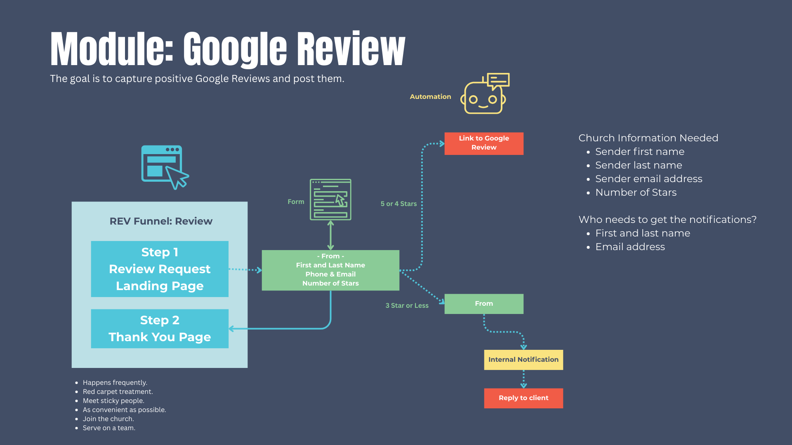

# \[REP] Reputation Management — SOP (Core & Spoke–Aligned)

**Module Name:** Reputation Management  
**Module Prefix:** REP  
**Version:** 1.1 (Updated)  
**Last Updated:** Sep 17, 2025  
**Owner:** Church Brand Guide Ops  

---

## 1.0 Purpose and Scope

**Purpose:**
The Reputation Management module (REP) captures and manages online reviews, routes negative feedback internally, and automates follow-up requests. It ensures positive experiences are amplified publicly and negative experiences are handled privately.

**Scope (In-Scope):**

* Funnel to capture star ratings and route to third-party review platforms
* Survey to collect structured feedback
* Trigger links for campaigns
* Automated workflows for review requests, link clicks, and feedback routing
* Email templates and SMS snippets to manage communications

**Audience:**

* Implementers (agency staff building module)
* Church communications and guest services team
* Ministry leaders responsible for reputation and feedback

---

## 2.0 Asset Inventory

### 2.1 Folder Structure

All assets live in **\[Spoke] – Reputation Management** unless noted otherwise.
Sub‑folders: Funnels, Forms, Workflows, Email Templates, SMS Snippets.

### 2.2 Assets

**Funnels**

* `[REP] – Review Funnel`

  * Page 1: `REP Review Page` — Captures review and redirects to 3rd party if 4–5 stars

**Survey**

* `[REP] – Google Review Survey`

  * Fields:

    * `Spoke_REP_Rate_Us` (1–5 stars)
    * `contact.fullname`
    * `contact.email`
    * `Spoke_REP_Your_Feedback`

**Trigger Links**

* `[REP] – Review Request Link`

  * Purpose: Initiates review request workflow
  * URL: `Spoke_REP_Trigger_Link`

**Workflows**

* `[REP] – 1 Past Customers – Ask For Review` — Trigger: `tag: Review Campaign`
* `[REP] – 2 Review Link Clicked` — Trigger: `link click: Review Request Link`
* `[REP] – 3 Negative Feedback Received` — Trigger: `survey submission 1–3 stars`
* `[REP] – Ongoing Review Campaign` — Trigger: `tag: Request Review`

**Email Templates**

* `[REP] – Review Template 1` — Ask for review
* `[REP] – Past Visitors – Message 1` — Ask for review
* `[REP] – Past Visitors – Message 2` — Follow-up reminder
* `[REP] – Negative Feedback – Alert to Staff` — Internal alert for negative feedback
* `[REP] – Negative Feedback – Response to Contact` — Response to negative feedback
* `[REP] – Ongoing Review Campaign – Message 1` — Ask new visitors for review
* `[REP] – Ongoing Review Campaign – Message 2` — Follow-up reminder

**SMS Snippets**

* `[REP] – Past Visitors – Text 1` — Ask for review
* `[REP] – Past Visitors – Text 2` — Follow-up reminder
* `[REP] – Ongoing Review Campaign – Text 1` — Ask new visitors for review
* `[REP] – Ongoing Review Campaign – Text 2` — Follow-up reminder

---

## 3.0 Custom Value Dictionary

### 3.1 Core Values (Global)

| Key                      | Description                  | Data Type |
| ------------------------ | ---------------------------- | --------- |
| `Core_Church_Name`       | Official church name         | Text      |
| `Core_Email_Sender`      | Default sender email address | Email     |
| `Core_Name_Sender_First` | First name of default sender | Text      |
| `Core_Name_Sender_Last`  | Last name of default sender  | Text      |
| `Core_Pastor_First_Name` | Lead pastor’s first name     | Text      |
| `Core_Pastor_Last_Name`  | Lead pastor’s last name      | Text      |
| `Core_Pastor_Email`      | Lead pastor’s email          | Email     |
| `Core_URL_Logo`          | URL for primary church logo  | URL       |
| `Core_URL_Logo_Alt`      | URL for alternative church logo | URL    |

### 3.2 Spoke Values (Module-Specific)

Stored in folder: `[Spoke] – Reputation Management`

| Key                                        | Description                                     |
| ------------------------------------------ | ----------------------------------------------- |
| `Spoke_REP_Form_Survey_URL`                | URL of the Review survey form                   |
| `Spoke_REP_Email_Staff_Notification_Email` | Staff notification recipient email              |
| `Spoke_REP_Coordinator_First_Name`         | First name of Reputation Management coordinator |
| `Spoke_REP_Coordinator_Last_Name`          | Last name of Reputation Management coordinator  |
| `Spoke_REP_Coordinator_Email`              | Email of Reputation Management coordinator      |
| `Spoke_REP_Review_Google_URL`              | Public URL for Google review submission link    |
| `Spoke_REP_Trigger_Link`                   | Public URL for review request trigger link      |
| `Spoke_REP_Review_Request_Link`            | Public URL for review request funnel link       |

### 3.3 Spoke Contact Fields (Module-Specific)

| Key                       | Description                            |
| ------------------------- | -------------------------------------- |
| `Spoke_REP_Rate_Us`       | Star rating (1–5) submitted by contact |
| `Spoke_REP_Your_Feedback` | Text feedback submitted by contact     |

---

## 4.0 Workflow Logic

### Workflow: `[REP] – 1 Past Customers – Ask For Review`

* **Trigger:** Tag `Review Campaign`
* **Steps:**

  1. SMS → `[REP] – Past Visitors – Text 1`
  2. Email → `[REP] – Past Visitors – Message 1`
  3. Wait 1 day
  4. Condition: If `Review Link Clicked` tag exists, go to step 7
  5. SMS → `[REP] – Past Visitors – Text 2`
  6. Email → `[REP] – Past Visitors – Message 2`
  7. Exit workflow

### Workflow: `[REP] – 2 Review Link Clicked`

* **Trigger:** Link click `[REP] – Review Request Link`
* **Steps:**

  1. Add tag: Review Link Clicked
  2. Remove from `[REP] – 1 Past Customers – Ask For Review`
  3. End

### Workflow: `[REP] – 3 Negative Feedback Received`

* **Trigger:** Survey submission with `Spoke_REP_Rate_Us` = 1–3
* **Steps:**

  1. Remove from `[REP] – 1 Past Customers – Ask For Review`
  2. Send Email → `[REP] – Negative Feedback – Alert to Staff`
  3. Send Email → `[REP] – Negative Feedback – Response to Contact`
  4. Exit workflow

### Workflow: `[REP] – Ongoing Review Campaign`

* **Trigger:** Tag `Request Review`
* **Steps:**

  1. Wait 20 minutes
  2. SMS → `[REP] – Ongoing Review Campaign – Text 1`
  3. Email → `[REP] – Ongoing Review Campaign – Message 1`
  4. Wait 1 day
  5. Condition: If `Review Link Clicked` tag exists, go to step 8
  6. SMS → `[REP] – Ongoing Review Campaign – Text 2`
  7. Email → `[REP] – Ongoing Review Campaign – Message 2`
  8. Exit workflow

---

## 5.0 Funnel Page Requirements

**Page 1: `[REP] – Review Page`**

* Purpose: Capture review submission and redirect to 3rd party site if 4–5 stars
* Content:

  * Headline: *How would you rate your experience at {{ Core\_Church\_Name }}?*
  * Embed: `Spoke_REP_Form_Survey_URL`
  * Branding: `Core_URL_Logo`

---

## 6.0 Deployment Checklist

* [ ] Create folders under `[Spoke] – Reputation Management`
* [ ] Import funnel, survey, workflows, emails, SMS
* [ ] Configure Core values
* [ ] Configure Spoke values
* [ ] Map all values inside assets
* [ ] Test end‑to‑end flow
* [ ] QA across desktop and mobile
* [ ] Activate and document in Module Dictionary

---

## 7.0 Governance Notes

* **Immutable Keys:** Never rename custom value Keys once created.
* **Promotion Rule:** Promote Spoke → Core only if ≥2 unrelated modules will use it.
* **Airtable Governance:** All assets and values must be logged in Airtable before creation.

---

✅ The Reputation Management module is now aligned with the Core & Spoke framework and ready for deployment.
