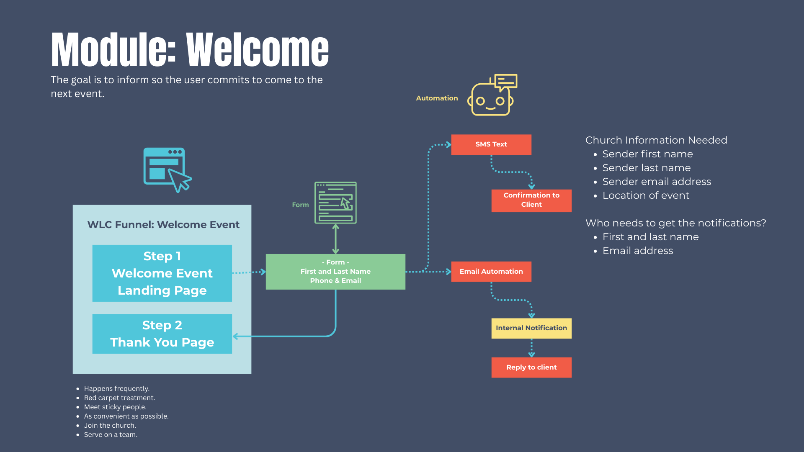

# \[WLE] Welcome Event — SOP (Core & Spoke–Aligned)

**Module Name:** Welcome Event
**Module Prefix:** WLE
**Version:** 1.0
**Last Updated:** Sep 15, 2025
**Owner:** Church Brand Guide Ops

---

## 1.0 Purpose and Scope

**Purpose:**
The Welcome Event module (WLE) captures RSVP details for the church’s main Welcome Event, automates confirmations and staff notifications, and ensures guests feel personally invited and cared for.

**Scope (In-Scope):**

* Funnel with form capture and thank-you page
* Automated workflows for RSVP confirmation and notifications
* Email templates and SMS snippets for visitor + staff communications
* Custom values for event details and coordinator info

**Audience:**

* Implementers (agency staff building module)
* Church communications and guest services team
* Ministry leaders responsible for new visitor engagement

---

## 2.0 Asset Inventory

### 2.1 Folder Structure

All assets live in **\[Spoke] – Welcome Event** unless noted otherwise.
Sub-folders: Funnels, Forms, Workflows, Email Templates, SMS Snippets.

### 2.2 Assets

**Funnels**

* `[WLE] – Welcome Event Funnel`

  * Page 1: `WLE Welcome Page` — Capture new visitor information
  * Page 2: `WLE Thank You Page` — Confirm RSVP and share details

**Forms**

* `[WLE] – Welcome Event Form`

  * Fields:

    * `contact.firstname`
    * `contact.lastname`
    * `contact.phone`
    * `contact.email`

**Workflows**

* `[WLE] – 1 New Visitors – Welcome Event`

  * Trigger: Form submission `[WLE] – Welcome Event Form`

**Email Templates**

* `[WLE] – Staff Notification – Message 1` — Notify staff of new RSVP
* `[WLE] – New Visitors – Message 1` — Confirm RSVP with event details

**SMS Snippets**

* `[WLE] – New Visitors – Text 1` — Confirm RSVP with event details

---

## 3.0 Custom Value Dictionary

### 3.1 Core Values (Global)

Stored in folder: `[Core] – Brand Values`

| Key                       | Description                             | Data Type |
| ------------------------- | --------------------------------------- | --------- |
| `Core_Church_Name`        | Official church name                    | Text      |
| `Core_Email_Sender`       | Default sender email address            | Email     |
| `Core_Name_Sender_First`  | First name of default sender            | Text      |
| `Core_Name_Sender_Last`   | Last name of default sender             | Text      |
| `Core_Pastor_First_Name`  | Lead pastor’s first name                | Text      |
| `Core_Pastor_Last_Name`   | Lead pastor’s last name                 | Text      |
| `Core_Pastor_Email`       | Lead pastor’s email                     | Email     |
| `Core_URL_Logo`           | URL for primary church logo             | URL       |
| `Core_Welcome_Event_Name` | Name of the church’s main welcome event | Text      |

### 3.2 Spoke Values (Module-Specific)

Stored in folder: `[Spoke] – Welcome Event`

| Key                                | Description                           |
| ---------------------------------- | ------------------------------------- |
| `Spoke_WLE_Location`               | Location of the Welcome Event         |
| `Spoke_WLE_Date`                   | Date of the Welcome Event             |
| `Spoke_WLE_Time`                   | Time of the Welcome Event             |
| `Spoke_WLE_Coordinator_First_Name` | First name of the event coordinator   |
| `Spoke_WLE_Coordinator_Last_Name`  | Last name of the event coordinator    |
| `Spoke_WLE_Coordinator_Email`      | Email of the event coordinator        |
| `Spoke_WLE_Event_Image_URL`        | Public URL of event promotional image |

---

## 4.0 Workflow Logic

**Workflow:** `[WLE] – 1 New Visitors – Welcome Event`
**Trigger:** Form submission `[WLE] – Welcome Event Form`

**Steps:**

1. SMS → `[WLE] – New Visitors – Text 1`
2. Email → `[WLE] – New Visitors – Message 1`
3. Email → `[WLE] – Staff Notification – Message 1`
4. Tag Contact → `Tag: Welcome Event Registered`
5. Remove from Workflow → `[WLE] – 1 New Visitors – Welcome Event`
6. End

---

## 5.0 Funnel Page Requirements

**Page 1: `[WLE] – Welcome Event Landing Page`**
*Purpose:* Capture visitor info and provide event details
*Content:*

* Headline: *Welcome to {{ Core\_Church\_Name }}! We’re glad you’re here.*
* Embed: `Spoke_WLE_Welcome_Event_Form`
* Branding: `Core_URL_Logo`

**Page 2: `[WLE] – Welcome Event Thank You Page`**
*Purpose:* Confirm RSVP and provide next steps
*Content:*

* Headline: *Thank you for signing up!*
* Body: *We look forward to seeing you at the {{ Core\_Welcome\_Event\_Name }} on {{ Spoke\_WLE\_Date }} at {{ Spoke\_WLE\_Time }} at {{ Spoke\_WLE\_Location }}.*
* Image: `Spoke_WLE_Event_Image_URL`
* Branding: `Core_URL_Logo`

---

## 6.0 Deployment Checklist

* [ ] Create folders under `[Spoke] – Welcome Event`
* [ ] Import funnel, form, workflow, emails, SMS
* [ ] Configure Core values
* [ ] Configure Spoke values
* [ ] Map all values inside assets
* [ ] Test end-to-end RSVP flow
* [ ] QA across desktop and mobile
* [ ] Activate and document in Module Dictionary

---

## 7.0 Governance Notes

* **Immutable Keys:** Never rename custom value Keys once created.
* **Promotion Rule:** Promote Spoke → Core only if ≥2 unrelated modules will use it.
* **Airtable Governance:** All assets and values must be logged in Airtable before creation.

---

### Appendix A: Module Data Input Template (Pre‑SOP)

Use this to collect inputs when instantiating the module for a new church.

**Module Identity**

* Module Name: `Welcome Event`
* Module Prefix: `WLE`

**Funnels**

* Funnel Name: `[WLE] – Welcome Event Funnel`

  * Page 1: `WLE Welcome Page` — Welcome + Info Capture
  * Page 2: `WLE Thank You Page` — Confirmation + Next Steps

**Form**

* `[WLE] – Welcome Event Form`

  * `contact.firstname`, `contact.lastname`, `contact.phone`, `contact.email`

**Workflow**

* `[WLE] – 1 New Visitors – Welcome Event` — Trigger: form submission

**Email Templates**

* `[WLE] – Staff Notification – Message 1` — Notify staff of new RSVP
* `[WLE] – New Visitors – Message 1` — Confirm RSVP + details

**SMS Snippets**

* `[WLE] – New Visitors – Text 1` — Confirm RSVP + details

**Core Values**
`Core_Church_Name`, `Core_Email_Sender`, `Core_Name_Sender_First`, `Core_Name_Sender_Last`, `Core_Pastor_First_Name`, `Core_Pastor_Last_Name`, `Core_Pastor_Email`, `Core_URL_Logo`, `Core_Welcome_Event_Name`

**Spoke Values (WLE)**
`Spoke_WLE_Location`, `Spoke_WLE_Date`, `Spoke_WLE_Time`, `Spoke_WLE_Coordinator_First_Name`, `Spoke_WLE_Coordinator_Last_Name`, `Spoke_WLE_Coordinator_Email`, `Spoke_WLE_Event_Image_URL`

